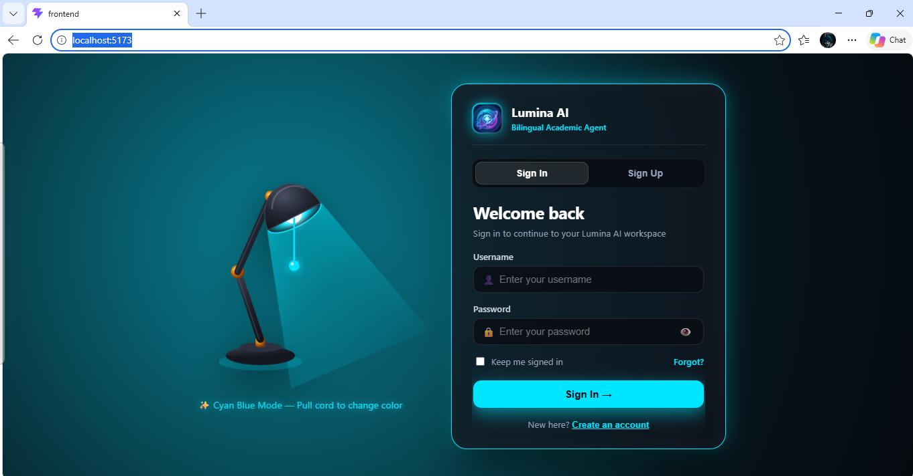
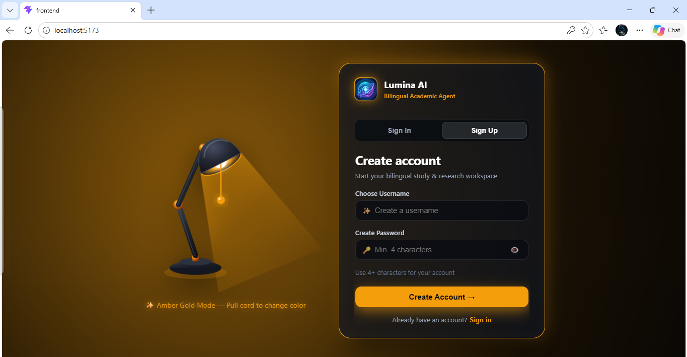
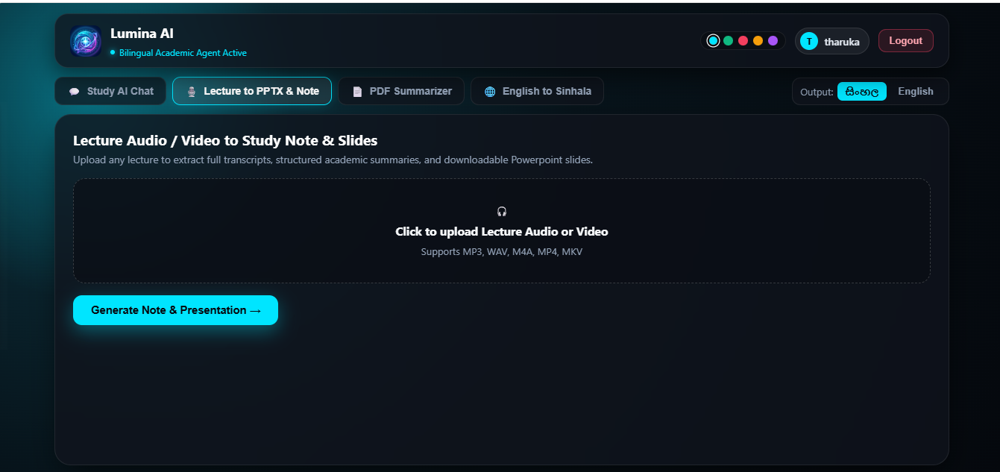

# ✨ Lumina AI — Bilingual Multimodal Academic Assistant

**Lumina AI** is a full-stack, bilingual (Sinhala & English) AI-powered academic assistant built with **React**, **FastAPI**, and **Google Gemini 2.0**. It helps students across multiple disciplines (Science, IT, Commerce, Law, Medicine, and Arts) automate study note creation, lecture transcription, and academic research.

> **Project Status:** 🚧 *Active Development — Core multimodal features and UI completed; currently preparing for cloud deployment.*

---

## 📸 Preview

| 3D Desk Lamp Sign-In | Account Registration UI |
| :---: | :---: |
|  |  |

| Bilingual AI Study Chatbot | Lecture to PPTX & Study Notes |
| :---: | :---: |
|  |  |

---

## 🚀 Key Features

* **Interactive 3D Desk Lamp Auth UI:** Custom SVG articulated desk lamp with pull-cord physics, dynamic ambient room lighting themes, diagonal slide transitions, and SHA-256 secured **SQLite** authentication.
* **Bilingual Academic Research Chatbot:** Context-aware multi-turn AI chat supporting Sinhala and English with real-time **Web Speech API** voice-to-text input.
* **Lecture Audio/Video to PPTX & Notes:** Uploads lecture recordings to **Gemini 2.0 Multimodal API** to extract full transcripts, structured exam notes, and downloadable `.pptx` presentations (`python-pptx`).
* **Academic PDF Summarizer:** Parses study handouts and textbooks (`pypdf`) into structured, exam-ready summaries.
* **Terminology-Preserving Translator:** Translates English academic notes into clear Sinhala while retaining vital technical and scientific terms.

---

## 🛠️ Tech Stack

* **Frontend:** React.js (Vite), Axios, CSS3 (Glassmorphism & Custom Animations), Web Speech API
* **Backend:** Python, FastAPI, Uvicorn, SQLite3
* **AI & Document Processing:** Google GenAI SDK (`gemini-2.0-flash-lite`), `python-pptx`, `pypdf`